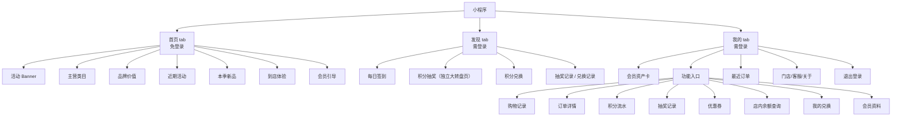
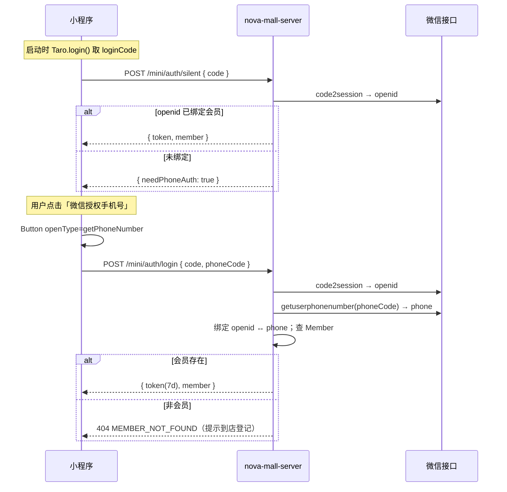

# 会员小程序（nova-miniapp）方案 v1

> 状态：**待评审**　原型：[demo/miniapp.html](../demo/miniapp.html)　目标工程：`nova-miniapp/`　后端：`nova-mall-server/`
> 旧实现参考：`/Users/bondli/githubProjects/nova/apps/miniapp`（只读，不迁移）

## 0. 结论摘要

- 重做一套 3 Tab 小程序：**首页（免登录）/ 发现（需登录）/ 我的（需登录）**，替代旧版「首页即登录页 + 单页跳转」的结构。
- 技术栈沿用旧版：**Taro 4.1.8 + React 18 + TypeScript + SCSS**，UI 以原型为准自建轻组件，仅用 NutUI 的 Toast / Popup 等少数基础件，避免旧版整页 NutUI 带来的视觉同质化。
- 登录仍是**微信授权手机号**，手机号即会员号；新增 **JWT 登录态**与 **openid 静默续期**，会员接口不再接受 `?phone=` 裸传参。
- 发现 Tab 的三个能力（签到、积分抽奖、积分兑换）现有服务端**均不具备**，需要在 `nova-mall-server` 新增表、接口与事务；其余（订单、积分、余额、券、抽奖记录、资料）在旧接口基础上升级为分页 + 鉴权。
- **积分兑换是 v1 核心闭环**：POS 端的满减/满送券由门店活动自动发放，会员在小程序内用「消费 + 签到」获得的积分兑换实物礼品，兑换后凭取货码**到店自提**，把线上积分沉淀转成线下客流。
- 首页对齐天猫旗舰店结构，固定三块关键内容：**① 活动 banner　② 主营类目（图卡 + 尺码）　③ 品牌价值（ABOUT DAVE&BELLA）**，其下保留近期活动、本季新品、到店体验与会员引导。
- 视觉主色由蓝色科技风改为**品牌红 `#ff0f23`**（浅底 `#fff1f2`、深红 `#c7001a`），与门店/品牌物料一致。
- 新接口统一放在 `/mini/*` 命名空间，**旧 `/member/*`、`/order/*` 等接口原样保留**，避免旧小程序线上不可用。
- 首页内容 v1 采用**服务端配置 + 营销活动实时数据**：门店/品牌/产品力/精选商品由 `~/.nova/mall-config.json` 的 `miniHome` 段驱动，活动读 `Marketing` 表；不新增运营后台。
- 编码前置条件：§11 的 D1–D10 决策确认；确认后按 §9 的 M0–M5 分阶段实施，每阶段过质量门禁。

---

## 1. 背景与目标

### 1.1 旧版现状（/Users/bondli/githubProjects/nova/apps/miniapp）

| 维度 | 旧版 |
|---|---|
| 信息架构 | 无 tabBar；首页即登录页，登录后进入订单 / 积分 / 余额 / 活动 / 资料 |
| 登录 | `getPhoneNumber` → `POST /member/login` → 本地存 `user`，无 token |
| 数据访问 | 所有会员接口凭 `phone` 查询，无鉴权、无分页（默认一次取 100 条） |
| 营销能力 | 只有活动列表 / 详情；无签到、无抽奖、无领券 |
| 视觉 | NutUI 默认风格，缺少门店品牌表达 |

主要问题：**没有对外窗口**（未登录用户看不到门店价值）、**会员接口裸奔**、**营销互动缺失**、**列表无分页**。

### 1.2 新版目标

1. **首页承担获客与品牌表达**：不登录也能知道「这家店卖什么、为什么值得买、最近有什么活动」。
2. **发现承担会员互动**：签到、积分抽奖、积分兑换，形成到店/复购理由。
3. **我的承担会员自助**：资产、购物记录、积分流水、抽奖记录、优惠券、兑换记录、店内余额，一屏可查。
4. **登录门禁清晰**：只有首页免登录，其余入口统一引导微信授权手机号。
5. **安全与可运营**：JWT 鉴权、接口分页、并发安全、配置可调，不破坏旧小程序。

### 1.3 成功标准（v1 验收口径）

- 未登录可完整浏览首页与活动，不出现任何会员数据请求。
- 发现/我的任意入口在未登录时 100% 出现登录引导；登录后刷新/重启仍保持登录态（7 天内）。
- 签到每日仅一次、断签重置；抽奖扣分与发奖原子完成；积分兑换库存不超卖、每人限兑、扣分与生成取货码原子完成。
- 所有列表分页可用，首屏 ≤ 2s（本地网络）。
- `nova-miniapp` typecheck / lint / 构建通过；`nova-mall-server` typecheck / lint 通过。

---

## 2. 信息架构与登录门禁

### 2.1 页面结构



- tabBar 固定 3 项：`home` / `discover` / `mine`，主色 `#ff0f23`，未选中 `#a1a1aa`。
- 子页面不做独立 tab，统一从「我的」进入；订单详情、优惠券筛选等用页面而非弹层（小程序原生更顺滑）。
- 未登录时不跳转登录页，而是**在当前页渲染登录引导卡片**（与 demo 一致），点击后拉起微信授权弹层；这样不打断 tab 浏览。

### 2.2 页面清单

| # | 路由 | 页面 | 登录 | 说明 |
|---|---|---|---|---|
| 1 | `pages/index/index` | 首页 | 否 | tabBar；同时作为小程序码落地页 |
| 2 | `pages/discover/index` | 发现 | 是 | tabBar，未登录渲染 `LoginGuide` |
| 3 | `pages/mine/index` | 我的 | 是 | tabBar，未登录渲染 `LoginGuide` |
| 4 | `pages/orders/index` | 购物记录 | 是 | 状态筛选 + 分页 |
| 5 | `pages/order-detail/index` | 订单详情 | 是 | 传 `orderSn` |
| 6 | `pages/points/index` | 积分流水 | 是 | 分页 |
| 7 | `pages/draws/index` | 抽奖记录 | 是 | 分页 |
| 8 | `pages/coupons/index` | 优惠券 | 是 | 可用/已使用/已过期 |
| 9 | `pages/balance/index` | 店内余额 | 是 | 余额卡 + 流水 |
| 10 | `pages/redeem/index` | 积分兑换 | 是 | 兑换商品列表 + 确认兑换 |
| 11 | `pages/redeem-records/index` | 我的兑换 | 是 | 待取货/已取货，展示取货码 |
| 12 | `pages/draw/index` | 积分抽奖 | 是 | 大转盘 + 中心抽奖按钮，10 积分/次，每日 5 次 |
| 13 | `pages/profile-edit/index` | 修改资料 | 是 | 昵称/生日可改，手机号与等级只读；从「我的-资料」浮层进入 |

### 2.3 登录门禁实现

- 全局登录态存 zustand `userStore`：`token` / `member`，持久化到 `Taro.setStorageSync('nova_token')`。
- 每个需登录页面首屏检查 `token`：无 token → 渲染 `LoginGuide`（锁图标 + 权益说明 + 登录按钮），**不发起会员接口**。
- 接口返回 `401` → 清空登录态 → 当前页切回 `LoginGuide` 并提示「登录已过期」。
- 登录成功后：更新 store，`navigateBack` 或原地重渲染当前页数据。
- 首页顶部品牌条**不放登录入口**，右侧固定一行小字「专注 0-14 岁儿童服饰」；登录入口只保留在首页底部会员引导卡，点击拉起微信授权弹层。

### 2.4 登录流程（微信授权手机号 + 静默续期）



- **手机号即会员号**：不对手机号做任何创建会员操作，未查询到会员时引导到店登记 / 联系门店。
- `MemberIdentity` 表保存 `openid ↔ phone` 绑定，用于 7 天后 token 过期时的静默续期；首次仍需手机号授权。
- JWT：HS256，`sub=phone`，`openid` 放 payload，有效期 7 天；密钥首次启动自动生成到配置文件。

---

## 3. 页面详细设计

### 3.1 首页（免登录）

> 结构对齐天猫旗舰店：三块关键内容固定在首屏，其余模块向下延伸。首页不请求任何会员接口。

| 顺序 | 模块 | 内容 | 数据来源 | 备注 |
|---|---|---|---|---|
| 0 | 品牌条 | `Dave & Bella` + 副标 `KIDS 0-14` + 右侧小字「专注 0-14 岁儿童服饰」 | 配置 `miniHome.brand` | 替代旧版大 Hero，压缩首屏高度；不放登录入口 |
| 1 | **活动 Banner** | 横滑 3 张：秋冬满减、积分兑换上新、会员日双倍积分；含标签、主标题、副文案、CTA、圆点指示 | 配置 `miniHome.banners`（活动类可由 `Marketing` 覆盖） | 图片失败用红色渐变兜底，文案始终可读；点击跳活动/兑换页 |
| 2 | **主营类目** | 3×2 图卡：女小童 / 男小童 / 女大童 / 男大童 / 婴儿 / 童鞋，每卡含竖版人物图 + 类目名 + 尺码区间 | 配置 `miniHome.categories` | 图卡高度统一，尺码区间必须展示（73-150 / 110-160 / 0-1岁 / 0-13岁） |
| 3 | **品牌价值** | 一张横向儿童外景图 + `ABOUT DAVE&BELLA` + 「因爱而生　为爱创造」+ 品牌简介 + 三个数据（3000万+ 家庭 / A 类标准 / 0-14 岁） | 配置 `miniHome.brandStory` | 替代旧版「为什么选择」四宫格，信息更聚焦 |
| 4 | 近期活动 | 活动名、描述、状态按钮（了解 / 进行中） | `Marketing`（`endTime > now`） | 复用现有 `/mini/marketings` 公开接口 |
| 5 | 本季新品 | 横向 4 张商品卡：图、标签、名称、描述、销售价（红）+ 划线吊牌价 | 配置 `miniHome.products` | 两个价格字段；v1 不接实时库存 |
| 6 | 到店体验 | 门店图、名称、商圈地址、营业时间、导航/电话 | 配置 `store` | 导航用 `Taro.openLocation` |
| 7 | 会员引导 | 「登录解锁签到 / 抽奖 / 兑换」卡片 | 前端静态 | 点击拉起登录 |

- 活动与门店接口失败时降级：隐藏活动区、门店信息读本地配置兜底，**不阻断首页**。
- Banner 与类目图必须来自配置（运营可换图），代码内不硬编码图片地址。

### 3.2 发现（需登录）

#### 3.2.1 每日签到

- 7 天为一个周期，奖励依次 **5 / 5 / 5 / 10 / 10 / 10 / 30 积分**（与原型一致）。
- 连续规则：以自然日计算；昨日未签到则连续天数重置为 1；断签不清空历史记录。
- 每日仅一次：`MemberSignIn(phone, signDate)` 唯一索引兜底；重复请求返回「今日已签到」而不是报错。
- 签到成功：写 `MemberSignIn` + `Member.increment(point)` + `MemberScore(type='signin')`，同一事务。
- 页面展示：连续天数、7 天奖励条（已签/今日/未来）、今日按钮（立即签到 / 已签到）、积分余额入口。

#### 3.2.2 积分抽奖

- **独立页面** `pages/draw/index`：发现页抽奖卡只做入口，点击进入大转盘页；页面含 6 扇区转盘、顶部指针、中心「抽奖」按钮、今日剩余次数、当前积分与抽奖规则。
- 交互：点击中心按钮 → 转盘旋转 5 圈后停在服务端返回的奖品扇区（前端只负责动画落点，结果以服务端为准）→ 弹出结果层（收下 / 再抽一次）；旋转期间按钮禁用，防止连点。
- 单次消耗 **10 积分**，每日上限 **5 次**（配置可调）。
- 奖池以 `LotteryPrize` 表中 `status='active'` 的记录为准（当前 5 个奖品 + 谢谢参与，共 6 项）；转盘固定 6 扇区，增删奖品时必须保持 6 条 active 记录。发现页奖项列表由 `/mini/lottery/config` 实时返回，不在前端写死。

- 流程：客户端生成 `requestId`（uuid）→ 服务端事务内锁会员 → 校验积分与次数 → 扣 10 分 → 加权抽奖 → 发奖 → 写 `MemberDrawRecord` + `MemberScore`。
- 新会员首抽保底：无购物记录（`Order` 无 `orderType='normal'`）且无历史抽奖记录视为新会员首次抽奖，跳过加权抽取，直接发「满 100 减 5 元券」（30 天有效），`extra.newMember=true`。
- 入会赠送：小程序首次登录自动注册会员时赠送 10 积分（`MemberScore` reason=`入会赠送`），POS 新增会员同样赠送 10 积分。
- 幂等：`MemberDrawRecord(phone, requestId)` 唯一索引；重复提交直接返回原结果，不重复扣分。
- 抽奖结果弹层：中奖/未中奖两态，展示奖品与「收下 / 再抽一次」。
- 抽奖记录：`award` 存奖品名，`extra` 存 `{ requestId, cost, prizeId }`；列表展示奖品、时间、消耗、是否中奖。

#### 3.2.3 积分兑换（替代抢券）

- 业务定位：POS 端满减/满送券由门店活动自动发放，小程序**不再做抢券**；积分统一用于兑换实物礼品，兑换成功后到店自提，形成二次到店客流。
- 商品来源：新建 `RedeemItem`（礼品名、图片、所需积分、总库存、剩余库存、每人限兑、排序、状态、详情说明）。
- 列表展示：礼品图、名称、说明、所需积分、剩余库存进度条、兑换按钮（积分不足 / 已兑完 / 兑换）。
- 兑换流程（单事务）：
  1. 锁会员行与礼品行（`FOR UPDATE`）；
  2. 校验积分充足、礼品上架且有库存、未超过每人限兑；
  3. 扣积分（`Member.decrement(point)` + `MemberScore(type='redeem')`）；
  4. 扣库存（条件更新 `stock > 0`，影响行数为 0 则回滚）；
  5. 生成 6 位取货码与兑换单号，写入 `RedeemOrder(status='pending_pickup')`；
  6. 返回取货码与兑换单。
- 幂等：`RedeemOrder(phone, requestId)` 唯一索引；重复提交返回原兑换单，不重复扣分。
- 取货：`RedeemOrder` 状态 `pending_pickup / picked / cancelled / expired`；有效期默认 **30 天**（配置可调），过期由定时任务或查询时按 `expiredAt` 懒判定。
- 核销：**v1 不做核销**，兑换单保持 `pending_pickup`，门店凭取货码人工发货；后续由 POS 端新增核销功能把状态改为 `picked`（表结构预留 `pickedAt` 与状态流转）。
- 页面文案必须明确：**兑换后 30 天内到店自提，逾期作废且积分不退**。

### 3.3 我的（需登录）

- 会员资产卡：昵称、脱敏等级标签、积分、余额、优惠券数量、累计到店实付。
- 六宫格：购物记录 / 积分流水 / 抽奖记录 / 优惠券 / 店内余额查询 / 我的兑换。
- 会员资产卡的「资料」按钮打开**只读资料浮层**（手机号、昵称、生日、等级），浮层底部为「修改资料」，点击进入 `pages/profile-edit/index` 修改昵称与生日。
- 最近订单：取订单列表前 3 条，点击进详情。
- 底部：门店信息、联系门店、关于、退出登录（二次确认）。
- 退出登录只清本地 token 与会员缓存，不调服务端（JWT 无状态）。

### 3.4 子页面要点

| 页面 | 关键内容 | 分页/交互 |
|---|---|---|
| 购物记录 | 全部/已完成/售后 tab；订单号、商品摘要、件数、实付、状态 | 上拉加载，20/页 |
| 订单详情 | 订单信息、商品清单、合计/优惠/实付、复制订单号、联系门店 | 单次加载 |
| 积分流水 | 当前积分卡 + 收入/支出流水 | 上拉加载，20/页 |
| 抽奖记录 | 奖品、时间、消耗、中奖标记 | 上拉加载，20/页 |
| 优惠券 | 可用/已使用/已过期；券面额、门槛、范围、有效期 | 三个 tab 分别分页 |
| 店内余额 | 可用余额卡 + 充值/消费流水 | 上拉加载，20/页 |
| 积分兑换 | 礼品图/名称/所需积分/库存进度，确认弹层展示积分明细与取货说明 | 单次加载，兑换后跳记录 |
| 我的兑换 | 待取货 / 已取货；兑换单号、礼品、积分、取货码、有效期 | 上拉加载，20/页 |
| 会员资料浮层 | 手机号、昵称、生日、等级只读展示；底部「修改资料」进入修改页 | 浮层 + 跳转 |
| 修改资料 | 昵称、生日可编辑；手机号、等级只读；保存后返回「我的」并刷新昵称 | 昵称非空校验 |

---

## 4. 后端设计（nova-mall-server）

### 4.1 分层与新增文件

```
nova-mall-server/src/
├── middleware/
│   ├── auth.ts          # JWT 校验，注入 req.member { phone, openid }
│   ├── rate-limit.ts    # 登录/抽奖/兑换限流（内存计数）
│   └── error.ts         # 统一错误响应
├── service/
│   ├── wechat-auth.ts   # code2session + openid 绑定
│   ├── signin.ts        # 连续天数计算、奖励发放
│   ├── lottery.ts       # 权重抽取、扣分、发奖
│   ├── coupon.ts        # 发券（会员券 + 计数 + 有效期，供 POS 活动复用）
│   ├── redeem.ts        # 积分兑换：扣分 + 扣库存 + 取货码
│   └── points.ts        # 积分增减 + 流水（统一入口）
├── router/
│   ├── mini-auth-controller.ts
│   ├── mini-home-controller.ts
│   ├── mini-profile-controller.ts
│   ├── mini-signin-controller.ts
│   ├── mini-lottery-controller.ts
│   ├── mini-redeem-controller.ts
│   └── mini-*.ts        # 订单/积分/余额/券/抽奖记录
├── model/
│   ├── memberIdentity.ts
│   ├── memberSignIn.ts
│   ├── lotteryPrize.ts
│   ├── memberDrawRecord.ts   # 与 pos 同表
│   ├── redeemItem.ts
│   └── redeemOrder.ts
└── utils/query.ts       # 分页 / zod 解析（从 pos-server 移植）
```

- `index.ts` 挂载 `/mini` 路由；`/mini/home`、`/mini/marketings`、`/mini/store`、`/mini/activities/:id` 公开，其余统一 `auth` 中间件（活动详情用可选鉴权，带 token 时返回领券状态）。
- 新增依赖：`jsonwebtoken`（服务端）、`zod`（若尚未直接依赖，确认后加）。

### 4.2 接口契约

统一响应：成功 `{ success: true, data, ... }`；失败 `{ success: false, code, message }`，并配合 HTTP 状态码。

#### 公开接口

| 方法 | 路径 | 入参 | 返回 |
|---|---|---|---|
| GET | `/mini/home` | - | `{ store, brand, banners, categories, brandStory, products, productDetail }` |
| GET | `/mini/products/:sn` | 款号（Inventory.sn） | `{ sn, name, brand, price, originPrice, image, detailImages, skus: [{ sku, color, size, stock, originalPrice }] }`；公开接口，素材取首页配置中同一款号商品 |
| GET | `/mini/marketings` | `pageSize=20&current=1` | `{ count, data: Marketing[] }` |
| GET | `/mini/store` | - | `{ name, address, phone, hours, lat, lng, image }` |
| GET | `/mini/activities/:id` | - | 活动详情 `{ id, name, description, theme, image, type, condition, value, startTime, endTime, coupons[] }`；`coupons[]` 含 `claimed / expired`，带 token 时返回真实领取状态 |

#### 鉴权接口

| 方法 | 路径 | 入参 | 返回/说明 |
|---|---|---|---|
| POST | `/mini/auth/login` | `{ code, phoneCode, encryptedData?, iv? }` | `{ token, expiresIn, member }`；手机号未注册时自动创建普通会员 |
| POST | `/mini/auth/silent` | `{ code }` | `{ token, expiresIn, member }` 或 `{ needPhoneAuth: true }` |
| GET | `/mini/profile` | - | 会员摘要（含 point/balance/coupon/actual/level） |
| PATCH | `/mini/profile` | `{ name?, birthday? }` | 更新后的会员摘要 |
| GET | `/mini/orders` | `pageSize=20&current=1&status?` | `{ count, data }`，仅 `orderType='normal'` |
| GET | `/mini/orders/:orderSn` | - | `{ order, items }`，校验订单归属当前手机号 |
| GET | `/mini/points` | `pageSize=20&current=1` | `{ count, data: MemberScore[] }` |
| GET | `/mini/balance` | `pageSize=20&current=1` | `{ count, data: MemberBalance[] }` |
| GET | `/mini/coupons` | `status=active|used|expired&pageSize=20&current=1` | `{ count, data }` |
| POST | `/mini/activities/:id/coupons/:couponId/claim` | - | `{ couponId, claimed: true }`；幂等键 `store-coupon:<couponId>`，重复领取 `ALREADY_CLAIMED`，过期 `COUPON_EXPIRED` |
| GET | `/mini/draws` | `pageSize=20&current=1` | `{ count, data }` |
| GET | `/mini/signin/status` | - | `{ todaySigned, streakDays, totalPoints, rewards[7], signedDates }` |
| POST | `/mini/signin` | - | `{ todaySigned, streakDays, addedPoints, totalPoints, rewards }` |
| GET | `/mini/lottery/config` | - | `{ cost, dailyLimit, todayCount, prizes[] }` |
| POST | `/mini/lottery/draw` | `{ requestId }` | `{ prize, prizeType, pointsAdded, record }` |
| GET | `/mini/redeems` | `pageSize=20&current=1` | `{ count, data: [{ item, remainStock, canRedeem, perMemberLeft }] }` |
| POST | `/mini/redeems/:id/redeem` | `{ requestId }` | `{ order: RedeemOrder, remainStock, points }`；积分不足 `INSUFFICIENT_POINTS`、已兑完 `OUT_OF_STOCK`、超限 `REDEEM_LIMIT` |
| GET | `/mini/redeem-orders` | `status?&pageSize=20&current=1` | `{ count, data: RedeemOrder[] }`，含取货码与有效期 |

- **所有鉴权接口不再接受 `phone` 参数**；手机号从 JWT `sub` 取。
- 订单详情必须校验 `Order.userPhone === token.phone`，避免越权查看订单。
- 分页统一 `resolvePagination`（默认 20，上限 100），排序白名单。

### 4.3 数据模型

> 表结构唯一来源仍在 `nova-pos-server/src/model/schema.sql`；`nova-mall-server` 侧模型保持同名同字段。所有新表只新增，不改现有列。

#### 新表

**MemberIdentity（openid 绑定）**

| 字段 | 类型 | 说明 |
|---|---|---|
| id | INT PK AI | |
| openid | VARCHAR(64) NOT NULL | 唯一索引 |
| phone | VARCHAR(20) NOT NULL | 会员手机号 |
| unionId | VARCHAR(64) NULL | 预留 |
| createdAt/updatedAt | DATETIME | |

索引：`UNIQUE(openid)`，`KEY(phone)`。

**MemberSignIn（签到）**

| 字段 | 类型 | 说明 |
|---|---|---|
| id | INT PK AI | |
| phone | VARCHAR(20) | |
| signDate | DATE | 签到自然日 |
| points | INT | 本次获得积分 |
| streakDays | INT | 本次连续天数 |
| createdAt | DATETIME | |

索引：`UNIQUE(phone, signDate)`，`KEY(phone, signDate)`（覆盖查询）。

**LotteryPrize（抽奖奖池）**

| 字段 | 类型 | 说明 |
|---|---|---|
| id | INT PK AI | |
| name | VARCHAR(64) | 奖品名（展示） |
| prizeType | VARCHAR(16) | `none` / `points` / `coupon` |
| points | INT | `points` 类型发多少分 |
| couponCondition | DECIMAL(10,2) | 券门槛 |
| couponValue | DECIMAL(10,2) | 券面额 |
| couponDesc | VARCHAR(255) | 券描述 |
| couponValidDays | INT | 券有效天数 |
| weight | INT | 权重（正整数） |
| stock | INT NULL | 库存，NULL 表示不限 |
| status | VARCHAR(16) | `active` / `inactive` |
| sort | INT | 展示顺序 |
| createdAt/updatedAt | DATETIME | |

索引：`KEY(status, sort)`。

**RedeemItem（积分兑换礼品）**

| 字段 | 类型 | 说明 |
|---|---|---|
| id | INT PK AI | |
| name | VARCHAR(64) | 礼品名（如「儿童保温杯 450ml」） |
| image | VARCHAR(255) | 礼品图 |
| description | VARCHAR(255) | 规格 / 说明 |
| detail | TEXT NULL | 详情（领取说明、门店限制） |
| points | INT | 所需积分 |
| totalStock | INT | 总库存 |
| stock | INT | 剩余库存 |
| perMemberLimit | INT DEFAULT 1 | 每人限兑 |
| status | VARCHAR(16) | `active` / `inactive` |
| sort | INT | 展示顺序 |
| createdAt/updatedAt | DATETIME | |

索引：`KEY(status, sort)`。

**RedeemOrder（兑换单 / 取货凭证）**

| 字段 | 类型 | 说明 |
|---|---|---|
| id | INT PK AI | |
| orderNo | VARCHAR(32) | 兑换单号，唯一索引 |
| phone | VARCHAR(20) | 会员手机号 |
| itemId | INT | 礼品 id |
| itemName / itemImage | VARCHAR / VARCHAR | 下单快照，避免商品改价后记录失真 |
| points | INT | 实际扣除积分 |
| status | VARCHAR(20) | `pending_pickup` / `picked` / `cancelled` / `expired` |
| pickupCode | VARCHAR(8) | 6 位取货码 |
| expiredAt | DATETIME | 取货截止时间（默认 +30 天） |
| pickedAt | DATETIME NULL | 核销时间 |
| requestId | VARCHAR(64) | 幂等 |
| createdAt/updatedAt | DATETIME | |

索引：`UNIQUE(orderNo)`，`UNIQUE(phone, requestId)`，`KEY(phone, status, createdAt)`，`KEY(pickupCode, status)`。

**MemberDrawRecord（复用现有表）**

- 现有字段：`phone` / `info` / `award` / `extra`。
- 新增列：`requestId VARCHAR(64) NULL`；索引 `UNIQUE(phone, requestId)`（允许 NULL 重复，兼容旧数据）。
- `extra` 存 `{ cost, prizeId, prizeType }`；`info` 存奖品名；`award` 存发奖说明。

### 4.4 关键事务与并发

| 场景 | 做法 |
|---|---|
| 签到 | 事务内插入 `MemberSignIn`，捕获唯一冲突 → 返回已签到；成功则 `Member.increment(point)` + 写积分流水 |
| 抽奖 | `Member.findOne({ lock: UPDATE })` → 校验 point ≥ cost、今日次数 → 扣分 → 加权抽奖（锁 `LotteryPrize` 行，过滤库存）→ 发奖 → 写 `MemberDrawRecord`（唯一 requestId）+ 积分流水 |
| 积分兑换 | `Member.findOne({ lock: UPDATE })` → 校验 point ≥ item.points、未超限兑 → 扣分 → `RedeemItem` 条件更新 `stock > 0` 扣库存（影响行数 0 则回滚）→ 写 `RedeemOrder`（唯一 requestId）+ 积分流水 |
| 积分变动 | 统一走 `service/points.ts`：改 `Member.point` 与写 `MemberScore` 必须同事务，禁止只改一处 |
| 订单归属 | 详情查询条件带 `userPhone = token.phone`，不匹配返回 404 |

- 所有唯一索引冲突都视为**业务幂等**，返回成功态而非 500。
- 抽奖/兑换若客户端网络重试，`requestId` 保证只生效一次。
- 兑换涉及多个并发资源，锁顺序固定为**先会员、后礼品**，避免死锁。

### 4.5 配置扩展（`~/.nova/mall-config.json`）

```jsonc
{
  "jwt": { "secret": "<首次自动生成>", "expiresIn": "7d" },
  "store": {
    "name": "DaveBella 童装生活馆",
    "address": "杭州市 · 万象城 L3 · 儿童区",
    "phone": "0571-8888 6666",
    "hours": "10:00 - 22:00 · 周一至周日",
    "lat": 30.2525, "lng": 120.1644,
    "image": ""
  },
  "signin": {
    "rewards": [5, 5, 5, 10, 10, 10, 30],
    "resetOnMiss": true
  },
  "lottery": { "cost": 10, "dailyLimit": 5 },
  "redeem": { "pickupValidDays": 30, "perMemberDefault": 1 },
  "miniHome": {
    "brand": { "name": "Dave & Bella", "sublabel": "DAVE & BELLA · KIDS 0-14" },
    "banners": [{ "tag": "秋冬新品", "title": "秋冬焕新 满 1000 减 150", "desc": "全场童装通用 · 到店即享", "cta": "查看活动", "image": "", "link": "/pages/marketing/index" }],
    "categories": [
      { "name": "女小童", "size": "73-150cm", "image": "" },
      { "name": "男小童", "size": "73-150cm", "image": "" },
      { "name": "女大童", "size": "110-160cm", "image": "" },
      { "name": "男大童", "size": "110-160cm", "image": "" },
      { "name": "婴儿", "size": "0-1 岁", "image": "" },
      { "name": "童鞋", "size": "0-13 岁", "image": "" }
    ],
    "brandStory": {
      "title": "ABOUT DAVE&BELLA",
      "slogan": "因爱而生　为爱创造",
      "desc": "2011 年创立，专注 0-14 岁儿童服饰。坚持以 A 类婴幼儿标准做贴身衣物，用柔软面料与原创设计，陪伴超过 3000 万家庭的孩子长大。",
      "images": [""],
      "stats": [{ "value": "3000万+", "label": "家庭选择" }, { "value": "A 类", "label": "婴幼儿标准" }, { "value": "0-14 岁", "label": "全龄段覆盖" }]
    },
    "products": [{ "tag": "本季新品", "name": "奶油针织开衫", "desc": "A 类棉 · 珍珠扣", "price": "¥399", "originPrice": "¥499", "image": "" }]
  }
}
```

- 配置缺失时 `normalize` 补默认值，保证服务可启动；`jwt.secret` 首次生成后写回（权限 600）。
- 签到奖励、抽奖成本、兑换取货有效期改配置即生效，无需发版；奖池权重与兑换礼品在表内维护。

### 4.6 错误码与限流

| 错误码 | HTTP | 场景 |
|---|---|---|
| `UNAUTHORIZED` | 401 | 缺 token / token 过期 |
| `MEMBER_NOT_FOUND` | 404 | 手机号未登记会员 |
| `POINTS_NOT_ENOUGH` | 400 | 抽奖积分不足 |
| `DAILY_LIMIT` | 429 | 抽奖次数用尽 |
| `OUT_OF_STOCK` | 409 | 礼品已兑完 |
| `REDEEM_LIMIT` | 409 | 超过每人限兑 |
| `INSUFFICIENT_POINTS` | 400 | 兑换所需积分不足 |
| `ALREADY_SIGNED` | 200 | 今日已签到（成功态） |

- 限流：登录 10 次/分钟/IP；抽奖 10 次/分钟/手机号；兑换 10 次/分钟/手机号；内存计数，重启失效（单机够用）。

---

## 5. 前端工程（nova-miniapp）

### 5.1 技术栈与脚本

- Taro **4.1.8** + React **18** + TypeScript **5.6+** + SCSS；`@nutui/nutui-react-taro`（Toast / Popup / Button 等少量）；`zustand` 登录态。
- 不引入 TanStack Query / 新 UI 框架；列表用自建 `usePagedList` hook。
- 脚本（对齐仓库命名）：

```bash
npm run dev        # taro build --type weapp --watch
npm run build      # taro build --type weapp
npm run typecheck  # tsc --noEmit
npm run lint       # eslint .
npm run test       # vitest run（纯逻辑：签到连续、抽奖权重、金额格式化）
```

### 5.2 目录结构

```
nova-miniapp/
├── package.json / tsconfig.json / babel.config.js / project.config.json
├── config/index.ts                 # Taro 配置：appid、别名 @/*
├── src/
│   ├── app.tsx / app.config.ts / app.scss
│   ├── assets/                     # logo、占位图
│   ├── constants/                  # 奖励、文案、tab 配置
│   ├── services/
│   │   ├── request.ts              # baseURL、token 注入、401 处理、错误码映射
│   │   ├── auth.ts / home.ts / profile.ts
│   │   ├── order.ts / points.ts / balance.ts / coupon.ts / draw.ts
│   │   └── signin.ts / lottery.ts / redeem.ts
│   ├── stores/user.ts              # token/member/登录状态
│   ├── hooks/usePagedList.ts       # 分页 + 触底加载 + 三态
│   ├── components/
│   │   ├── LoginGuide.tsx          # 登录引导（锁 + 权益 + 按钮）
│   │   ├── AuthButton.tsx          # getPhoneNumber 封装
│   │   ├── MemberCard.tsx / SectionHeader.tsx / EmptyState.tsx
│   │   ├── ProductCard.tsx / CouponCard.tsx / SignInCard.tsx
│   │   ├── LotteryCard.tsx / RedeemCard.tsx / RecordRow.tsx
│   ├── pages/
│   │   ├── index/index.tsx
│   │   ├── discover/index.tsx
│   │   ├── mine/index.tsx
│   │   ├── orders/index.tsx / order-detail/index.tsx
│   │   ├── points/index.tsx / draws/index.tsx / coupons/index.tsx
│   │   ├── redeem/index.tsx / redeem-records/index.tsx
│   │   ├── draw/index.tsx / profile-edit/index.tsx
│   │   ├── balance/index.tsx
│   └── styles/                     # tokens.scss、mixins.scss
```

### 5.3 请求层

- `BASE_URL` 从 Taro 环境配置读取，开发 `http://127.0.0.1:9566`，生产按部署域名；**不硬编码在页面**。
- 请求头统一 `Authorization: Bearer <token>`；无 token 时不带。
- 401：清 store → 当前页显示 `LoginGuide`；403/404 按错误码给文案。
- 所有金额在 `services/*` 转 number，页面不做零散 `Number()`。
- 列表统一 `{ count, data }`，`usePagedList` 维护 `list/page/hasMore/loading/error`。

### 5.4 与 demo 的映射

| demo 区块 | 前端组件/页面 | 说明 |
|---|---|---|
| 手机壳、状态栏、tabbar | `app.config.ts` + 自定义 tabBar（或原生 tabBar 配图标） | 小程序原生 tabBar 更稳，图标用本地 PNG |
| 首页 品牌条 / 活动 Banner / 主营类目 / 品牌价值 / 近期活动 / 新品 / 门店 | `pages/index/index` + `BannerSwiper` / `CategoryGrid` / `BrandStory` / `ProductCard` / `SectionHeader` | 配置接口驱动；三块核心内容顺序不可调换 |
| 发现 签到卡 / 抽奖卡 / 积分兑换卡 | `pages/discover/index` + `SignInCard` / `LotteryCard` / `RedeemCard` | 未登录整体替换为 `LoginGuide`；抽奖卡点击进入 `pages/draw/index` |
| 抽奖大转盘页 | `pages/draw/index` + `Wheel` | 转盘按服务端结果停靠对应扇区，旋转中禁用按钮 |
| 我的 会员卡 / 六宫格（含我的兑换）/ 最近订单 | `pages/mine/index` + `MemberCard` | 六宫格跳子页；会员卡「资料」打开只读浮层，浮层底部进入 `pages/profile-edit/index` |
| 登录弹层 | `AuthButton` + `Popup` | 微信授权手机号；非会员提示到店登记 |
| 抽奖结果弹层 / 兑换成功弹层 | `Popup` | 兑换成功展示取货码与「30 天内到店自提」 |
| 订单/积分/券/余额/抽奖记录弹层 | 独立页面 | 小程序列表页体验优于弹层 |

### 5.5 视觉与适配

- token 与品牌物料一致：品牌主色 `#ff0f23`、浅红底 `#fff1f2`、深红 `#c7001a`、背景 `#f4f4f5`、卡片白、边框 `#e4e4e7`、正文 `#18181b`、次要 `#71717a`、成功 `#16a34a`、警示 `#b45309`。
- 圆角：卡片 16px、按钮 10px、胶囊 999px；间距 4px 基线；设计稿按 375 宽适配，`rpx` 换算。
- 图标统一 Lucide 风格线性图标，落地为本地 SVG/PNG 资源；**不引入 emoji 图标**。
- Banner、类目图、品牌图缺失时统一用红色渐变兜底（与 demo 一致），不出现空白块。

---

## 6. 非目标（v1 不做）

- 不做线上商城 / 下单 / 支付；小程序只做门店展示、会员权益与互动。
- 不做商品实时库存、SKU 详情、购物车。
- 不做运营后台；首页内容通过配置文件维护，兑换礼品与奖池通过 SQL / 运维脚本维护。
- 不做多门店、门店切换、跨店数据。
- 兑换核销 v1 不做，由门店线下登记，POS 端核销在二期接入；不做线上实物抽奖。
- 不改旧小程序代码与旧接口协议。

---

## 7. 实施阶段与验收门禁

| 阶段 | 内容 | 交付 | 门禁 |
|---|---|---|---|
| **M0 工程与协议** | 初始化 `nova-miniapp`；确定接口契约；mall-server 加 JWT/分页/错误中间件与 `MemberIdentity` | 可启动的空壳 3 Tab + `/mini/auth/*` | `npm run typecheck` / lint；curl 登录链路通过 |
| **M1 首页** | `/mini/home`、`/mini/marketings`、配置扩展；首页「活动 Banner / 主营类目 / 品牌价值」三块核心 + 其余模块 | 免登录首页 | 未登录零会员请求；图片兜底；三块核心内容顺序与文案验收；真机预览 |
| **M2 登录与我的骨架** | 微信登录/静默续期、`LoginGuide`、会员资产卡、六宫格、资料页 | 登录闭环 | 未登录拦截；重启保持登录；非会员提示 |
| **M3 我的数据页** | 订单/详情、积分、余额、券、抽奖记录接口与页面 | 5 个记录页 + 订单详情 | 分页、越权校验、空态/错误态 |
| **M4 发现** | 签到表与接口、抽奖表/奖池/接口、兑换礼品表/兑换单/接口 | 签到 / 抽奖 / 积分兑换 / 兑换记录 | 每日一次、扣分发奖、库存不超卖、每人限兑、幂等、取货码正确 |
| **M5 联调与验收** | 真机全流程、异常路径、文档与 AGENTS 更新 | 可发布版本 | §1.3 全部成功标准；旧接口回归不受影响 |

- 每阶段结束：`nova-mall-server` typecheck + lint；`nova-miniapp` typecheck + lint；涉及页面真机/开发者工具点一遍。
- 数据库变更随 M0/M4 提交 `migrations/*.sql`，**人工执行**，执行前备份。

---

## 8. 风险与取舍

| 风险 | 影响 | 应对 |
|---|---|---|
| 微信手机号接口需企业主体与额度 | 登录不可用 | 复用旧 appid 与已配置凭证；真机联调提前验证 |
| 旧接口与新接口并存 | 维护成本 | 旧接口冻结，仅修 bug；新功能只进 `/mini` |
| mall-server 与 pos-server 共享表 | 结构漂移 | 新表 DDL 统一写 `nova-pos-server/src/model/schema.sql`，mall 模型逐字段对齐；`database.sync` 生产关闭 |
| 抽奖/兑换并发 | 超发、重复扣分 | 行锁 + 唯一索引 + `requestId` 幂等 |
| 首页内容靠配置 | 运营不顺手 | v1 可接受；后续可加桌面端「小程序内容」配置页 |
| 微信审核 | 上线延迟 | 首页免登录、无诱导分享、抽奖概率公示、隐私协议齐全 |

---

## 9. 已确认决策（D1–D10）

> 评审结论：D1–D10 全部按推荐值执行。另确认 4 项实施口径：**只做真实微信登录（不做 mock）**；**迁移 SQL 由业务方手动执行**；**图片先用本地占位图（配置可替换）**；**v1 不做兑换核销（后续 POS 端实现）**。

| # | 决策 | 推荐 | 备选 |
|---|---|---|---|
| D1 | 技术栈 | Taro 4.1.8 + React 18 + TS + SCSS，少量 NutUI | 纯原生小程序 / uni-app |
| D2 | 接口命名空间 | 新增 `/mini/*`，旧接口保留 | 直接改旧接口（会破坏旧小程序） |
| D3 | 登录态 | JWT 7 天 + `MemberIdentity` openid 静默续期 | 仅 JWT，过期后重新授权手机号 |
| D4 | 首页内容来源 | 配置文件 `miniHome` + `Marketing` 实时活动 | 新建运营后台 / 读取 Inventory |
| D5 | 首页精选商品 | 配置化（图/名/价），不接实时库存 | 接 Inventory（当前无商品图字段） |
| D6 | 签到规则 | 7 天循环 5/5/5/10/10/10/30，断签重置 | 每日固定 5 分、无连续奖励 |
| D7 | 抽奖规则 | 10 分/次、每日 5 次、仅积分与券 | 增加实物奖品 / 不限次数 |
| D8 | 积分兑换模型 | 新建 `RedeemItem` + `RedeemOrder`，兑换后到店自提 | 复用 `Marketing` + `StoreCoupon`（券类活动由 POS 自动发放，不承担实物库存/取货语义） |
| D9 | 购物记录范围 | 仅 `orderType='normal'`，充值在余额流水体现 | 同时展示充值单 |
| D10 | 小程序 appid | 复用 `wx9a6777fceb2b3505` | 新申请 appid（需重新配置凭证与审核） |

---

## 10. 编码阶段预估改动清单

**nova-mall-server**

- 新增：`middleware/{auth,rate-limit,error}.ts`、`service/{wechat-auth,points,coupon,signin,lottery,redeem}.ts`、`router/mini-*.ts`、`model/{memberIdentity,memberSignIn,lotteryPrize,memberDrawRecord,redeemItem,redeemOrder}.ts`、`utils/query.ts`
- 修改：`config.ts`（store/jwt/signin/lottery/redeem/miniHome）、`index.ts`（挂载 `/mini`）、`package.json`（jsonwebtoken）、`router/index.ts`（保留旧路由）

**nova-pos-server**

- 修改：`src/model/schema.sql`（新增 5 张表 + `MemberDrawRecord.requestId` 列与索引）
- 新增：`migrations/20261102_miniapp_member_engagement.sql`（人工执行）
- 修改：如 `MemberDrawRecord` 模型补 `requestId` 字段
- 预留（二期）：收银台兑换取货码核销接口与桌面端核销入口

**nova-miniapp（新建）**

- 工程配置：`package.json` / `tsconfig.json` / `babel.config.js` / `project.config.js` / `config/index.ts`
- 源码：`src/app.*`、3 个 tab 页、9 个子页（含积分兑换、我的兑换）、10 类组件、11 个 service、store、hooks、样式 token

**文档**

- `docs/miniapp-plan.md`（本文件）
- `docs/README.md`：索引加入本方案、原型说明更新为新版
- `AGENTS.md`：加入 `nova-miniapp` 子项目（命令、目录、端口、约定），**编码完成后同一提交更新**

---

## 11. 评审通过后的第一步

1. 按 D1–D10 结论回填本方案（无异议则按推荐值）。
2. M0：初始化 `nova-miniapp` 与 `/mini/auth/*`，先用真实微信凭证跑通「登录 → 拿 token → 调 `/mini/profile`」（前置：`~/.nova/mall-config.json` 的 `wechat.appId` / `wechat.appSecret` 必须先配置）。
3. 再进入 M1 首页。每周/每阶段结束提交可运行版本，避免一次性大改。
