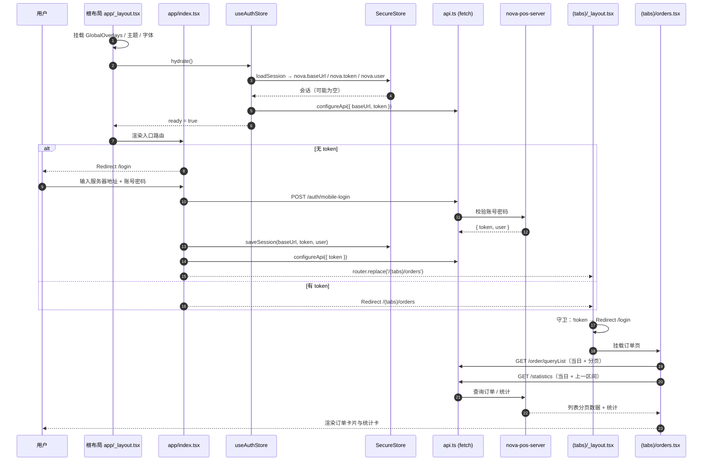
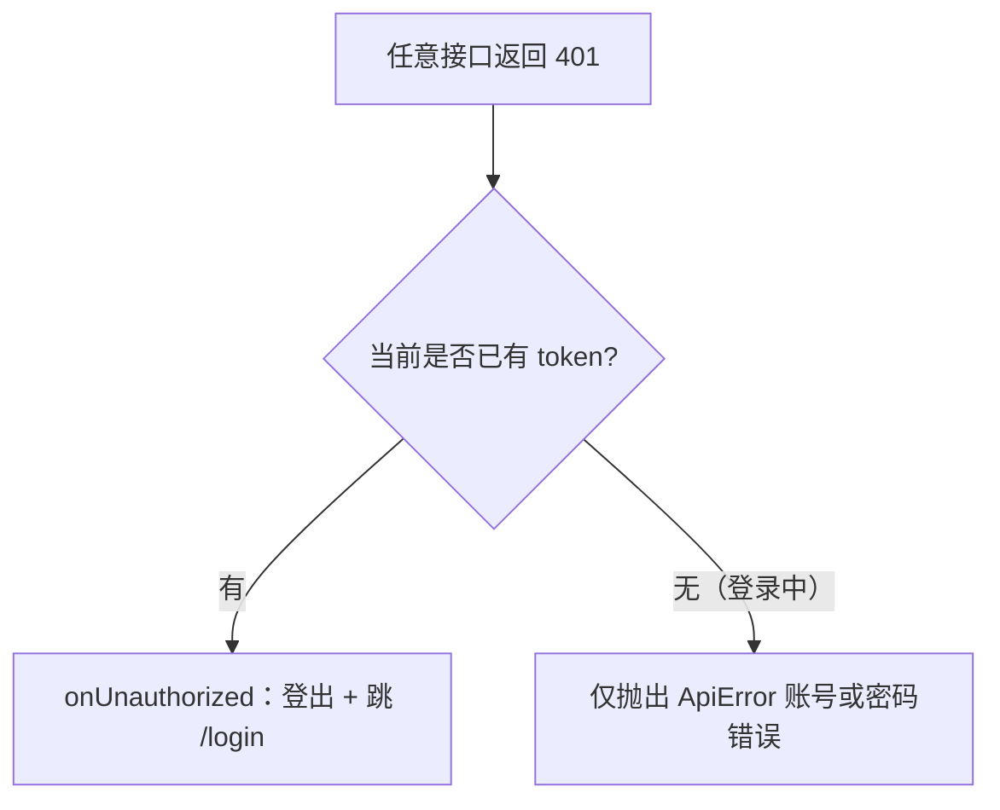

# nova-mobile 技术文档：交互逻辑、前端组件与启动时序

> 适用项目：`nova-mobile`（React Native + Expo SDK 58 + expo-router），服务端 `nova-pos-server`（Express + Sequelize）。
> 文档范围：①买单 / 修改订单 / 退货 / 换货四个关键流程与服务端的交互；②前端组件实现与关键 UI 逻辑；③App 启动 → 登录 → 订单首页加载的完整时序与逻辑图。
> HTML 可视化版本：[nova-mobile-architecture.html](nova-mobile-architecture.html)

---

## 0. 技术底座速览

| 关注点 | 方案 | 入口文件 |
| --- | --- | --- |
| 路由 | expo-router 文件路由，`app/` 即路由表 | `app/index.tsx`、`app/(tabs)/_layout.tsx` |
| 服务端状态 | TanStack Query（`useQuery` / `useInfiniteQuery`） | `app/**/*.tsx` |
| 本地 UI 状态 | Zustand（`useAuthStore` / `useCartStore` / `useUiStore`） | `src/stores/*` |
| 请求层 | 自研 `fetch` 封装 + `ApiError` | `src/lib/api.ts` |
| 接口封装 | 按业务域聚合的 `pos.ts` | `src/lib/pos.ts` |
| 持久化 | `expo-secure-store`（登录态）、SQLite（偏好设置） | `src/lib/storage.ts`、`src/theme/preferences.ts` |
| 主题 | 可变 `colors` 对象 + 订阅 revision + `themedStyles` | `src/theme/tokens.ts`、`src/theme/styles.ts` |
| 提示 | 全局 Toast 队列（`useUiStore.toasts`） | `src/components/toast.tsx` |

金额与数量约定：服务端以「元」为单位传输，前端用 `toCents` / `formatYuan` 在分与元之间转换，避免浮点误差（`src/lib/money.ts`）。

---

## 1. 与服务端交互的关键功能逻辑

### 1.1 通用请求层（`src/lib/api.ts`）

所有接口都走 `request(method, path, { query, body })`：

- **地址**：`configureApi({ baseUrl, token })` 设置全局 `state`；`normalizeBaseUrl` 自动补 `http://`、去掉尾部 `/`。默认地址 `DEFAULT_BASE_URL`，真机可在登录页改填局域网 IP。
- **鉴权**：请求头带 `Authorization: Bearer <token>`（登录请求本身不带 token）。
- **业务错误**：HTTP 200 但响应体含 `{ error: 'xxx' }` 时，经 `translate()` 翻译后抛 `ApiError`（`status` 记 200）。
- **401 分支**：有 token 时触发 `onUnauthorized`（根布局注册，执行登出并跳回 `/login`）；无 token 时（正在登录）只抛「账号或密码错误」类信息，不触发登出。
- **超时**：内部使用 `AbortController`，超时/网络异常统一转成 `ApiError`，页面只需 `caught instanceof ApiError ? caught.message : 兜底文案`。

页面层统一用 Toast 呈现错误，不再渲染行内红字：

```ts
showToast(caught instanceof ApiError ? caught.message : '操作失败，请稍后重试', 'error');
```

四个流程共用的 Query Key 约定：

| Query Key | 内容 | 失效时机 |
| --- | --- | --- |
| `['orders', start, end, search]` | 订单列表（无限分页） | 买单、修改、退货、换货成功后 |
| `['order-stats', start, end]` | 当日/区间统计（含环比上一区间） | 买单、退货、换货成功后 |
| `['order-detail', orderSn]` | 订单详情 | 修改、退货、换货成功后 |
| `['order-items', orderSn]` | 订单商品明细 | 修改、退货、换货成功后 |

---

### 1.2 买单（`app/(tabs)/buy.tsx`）

**入口与前置**：底部 Tab「买单」。购物车为空时不能收款；会员、优惠券、积分、余额均为可选。

**页面与状态**

- 加购：条码输入框 / 扫码（`openScanForCode`）→ `queryInventoryDetail(code)`；输入满 13 位自动查询。
- 会员：手机号输入 → `queryMemberDetail(phone)`，命中后展示等级、积分、余额；支持选择会员券、店铺券，开关「积分抵扣」「余额抵扣」。
- 商品行：数量步进（减到 0 即移除）、折扣（默认 `6` 即 6 折，1~10 一位小数）、删除图标。
- 收款抽屉：支付方式（微信 / 支付宝 / 现金 / 银行卡 / 其他）、实收金额（现金需找零）。
- 状态全部落在 `useCartStore`（`items / member / clerk / note / payment / received / usePoints / useBalance / memberCouponId / storeCoupons / storeCouponId`）。

**价格计算（`src/lib/pricing.ts`，纯函数）**

1. 行小计 = `round(吊牌价 × 数量 × 折扣 / 10)`；
2. `originalCents` = Σ 吊牌价 × 数量；`lineDiscountCents` = 原价 − 折后小计；
3. 会员券（满足门槛才可用）→ 店铺券，得到 `couponDiscountCents`；
4. 积分抵扣：`pointsUsed = min(会员积分, 剩余应付)`，1 分 = 1 分钱（100 分 = ¥1）；
5. 余额抵扣：`min(会员余额, 剩余应付)`；
6. `payableCents = max(0, 剩余)`，即最终应收。

**提交（`submitSale` → `POST /buy/submit`）**

```jsonc
{
  "buyer": { "phone", "usePoint", "useBalance", "useCoupon", "useCouponId" },
  "storeSaler": { "id", "name" },
  "waitSales": {
    "brief": { "counts", "totalAmount", "payAmount", "actualAmount", "payType", "remark" },
    "list": [{ "sn", "sku", "name", "color", "size", "originalPrice", "counts", "actualPrice" }]
  },
  "storeCoupons": [{ "id", "couponValue", "couponDesc" }]
}
```

- `brief.payAmount` = 原价 − 行折扣；`brief.actualAmount` = 最终应收（`payableCents`）。
- 行 `actualPrice` = 折后单价（`priceCents × discount / 10`）。
- 服务端返回订单号与实付金额，前端据此生成支付回执（`PaymentReceipt`）并展示收款成功抽屉。

**服务端处理**（`nova-pos-server/src/router/buy-controller.ts`）

- 创建订单 + 订单商品、扣减库存并写库存流水（L22-L124，事务内完成）；
- 更新会员消费金额 / 积分 / 余额，并写积分与余额流水（L126-L199）；
- 记录操作日志（买单）。

**失败与提示**：未加购、未选会员却用余额/积分、现金实收不足、接口报错，全部 `showToast(..., 'warning' | 'error')`。

**成功之后**：`invalidateQueries(['orders'])`、`['order-stats']`，清空购物车，展示回执。

---

### 1.3 修改订单（`app/order/edit.tsx`）

**入口**：订单列表 → 订单详情 → 修改订单（`/order/edit?orderSn=`）。

**表单与只读规则**

- 表单默认值直接由订单详情推导（`draft ?? derive(detail)`），用户改动才落到 `draft`，避免额外 `useEffect` 同步。
- `locked = detail.orderStatus === 'checked'`：**已对账订单只允许改备注**，支付方式、金额、会员手机号不可编辑，导购员只读。
- 非管理员：导购员固定为订单原导购，只读展示；管理员：可从 `loadClerks()` 列表选择（列表中已排除被禁用导购与管理员）。

**提交（`modifyOrder` → `POST /order/modify?orderId=<id>`）**

```jsonc
{ "orderSn", "payType", "orderActualAmount", "salerId", "userPhone", "remark" }
```

校验：实付金额必须为非负数字；管理员必须选导购；订单 `id` 缺失直接报错。失败用 Toast（`warning` / `error`）。

**服务端处理**（`order-controller.ts` L664-L780）：校验订单存在、订单号唯一；处理会员绑定/换绑；按新的实付金额重算会员消费金额、积分；写操作日志（modify）。

**成功之后**：Toast「订单已更新」→ 失效 `['orders'] / ['order-detail'] / ['order-items']` → `router.back()`。

---

### 1.4 退货（`app/order/refund.tsx`）

**入口**：订单详情 → 退货（`/order/refund?orderSn=`）。

**页面逻辑**

- 可退商品 = 明细中 `counts > 0` 的行，默认全选；勾选后可用步进器调整退回数量（`1 .. counts`）。
- 退款金额默认值 = Σ（行实付单价 × 退回数量），可手改，必须为非负数字。
- 退款去向 `amountType`：`money`（原路退款）/ `balance`（退回会员余额）。
- 校验：至少选一件商品；金额合法。失败 Toast。

**提交（`refundOrder` → `POST /order/refundItem`）**

```jsonc
{
  "orderSn": "...",
  "refundItems": [{ "id", "sku", "counts" }],
  "refundAmount": 0,
  "amountType": "money" | "balance"
}
```

**服务端处理**（`order-controller.ts` L472-L610）：更新订单状态为 `refund`；按退款去向减少订单实收或退回余额；修改订单商品数量；回滚库存；调整会员积分/余额；写操作日志（return）。

**成功之后**：Toast「退货已完成」→ 失效 `['orders'] / ['order-detail'] / ['order-items'] / ['order-stats']` → 返回。

---

### 1.5 换货（`app/order/exchange.tsx`）

**入口**：订单详情 → 换货（`/order/exchange?orderSn=`）。

**页面逻辑**

- 换出商品：与退货相同的勾选 + 数量步进，退回金额按行实付价计算。
- 换入商品：输入框支持 13 位条码自动查询；右侧扫码图标拉起扫码并把结果回填查询（`ScanLine` 图标按钮，查询中显示 loading）。查询命中后追加到换入列表，同 SKU 叠加数量。
- 换入销售价规则与桌面端一致：`吊牌价 × 0.6`（`SALE_RATE`）。
- 差价默认 = `|换入金额 − 换出金额|`，可手改；`amountType = none | add（补差价） | sub（退差价）`。
- 「退回余额」开关决定差价退回方式（`refundBalance`）。
- 校验：必须选换出商品、必须至少有一件换入商品、差价非负。

**提交（`changeOrder` → `POST /order/changeItem`）**

```jsonc
{
  "orderSn": "...",
  "returnItems": [{ "id", "sku", "counts", "originalPrice", "actualPrice" }],
  "exchangeItems": [{ "sku", "sn", "name", "color", "size", "originalPrice", "counts" }],
  "exchangeAmount": 0,
  "amountType": "none" | "add" | "sub",
  "refundBalance": false
}
```

**服务端处理**（`order-controller.ts` L296-L470）：更新订单实收金额与商品数量；修改/新增订单商品；换出库存回补、换入库存扣减；重算订单价格；调整会员积分/余额；写操作日志（exchange）。

**成功之后**：Toast「换货已完成」→ 失效 `['orders'] / ['order-detail'] / ['order-items'] / ['order-stats']` → 返回。

---

### 1.6 四个流程对照

| 维度 | 买单 | 修改订单 | 退货 | 换货 |
| --- | --- | --- | --- | --- |
| 接口 | `POST /buy/submit` | `POST /order/modify?orderId=` | `POST /order/refundItem` | `POST /order/changeItem` |
| 触发页面 | `app/(tabs)/buy.tsx` | `app/order/edit.tsx` | `app/order/refund.tsx` | `app/order/exchange.tsx` |
| 库存 | 扣减 | 不涉及 | 回补 | 回补 + 扣减 |
| 会员资产 | 实付/积分/余额 | 实付/消费额/积分 | 积分/余额 | 积分/余额 |
| 订单状态 | 新建 | 保持原状态（对账后锁定） | 置为 `refund` | 保持原状态 |
| 操作日志 | 买单 | modify | return | exchange |
| 可重复提交保护 | `saving` 布尔锁 | `saving` | `saving` | `saving` |

---

## 2. 前端组件与关键 UI 逻辑

### 2.1 组件清单（`src/components/ui.tsx`）

| 组件 | 作用 | 关键实现点 |
| --- | --- | --- |
| `AppHeader` | 顶部标题栏（可返回） | 统一状态栏安全区、返回箭头 |
| `Screen` | 页面骨架 | props：`title`、`back`、`scroll`、`footer`、`headerRight`；负责安全区、底部固定操作区、键盘避让 |
| `Card` | 内容分组卡片 | 圆角 + hairline 边框 + `colors.card` 背景 |
| `SectionTitle` / `Row` / `InfoBlock` / `RecordRow` | 段落标题、键值行、信息块、流水行 | 统一字号/间距，左标签右值 |
| `Badge` / `Chip` | 状态标签 / 可点选项 | 选中态使用品牌色描边 + 浅底 |
| `MetricCard` / `MiniMetric` | 指标卡 | 大号数字 + 小号标签，`fontVariant: tabular-nums` |
| `TabGroup` | 区间/类型切换 | 顶部胶囊分段器 |
| `TextField` | 输入框 | 支持 `label`、`clearable`（有值时右侧清除图标）、`keyboardType`、`editable` |
| `SearchField` | 搜索框（库存/订单/会员） | 放大镜 + 输入 + **有内容时显示 `close-circle` 一键清除** |
| `SelectField` | 下拉选择 | 点击打开 `SheetModal` 单选；新增 `placement: 'bottom' | 'top'`，操作日志页用顶部抽屉 |
| `SheetModal` | 底部/顶部抽屉 | RN `Modal`；`placement='top'` 时 `animationType='fade'`、圆角朝下、`paddingTop = insets.top + 8`；内部再渲染一份 `ToastHost`（Android Modal 独立窗口会遮挡根层 Toast） |
| `Button` | 主按钮 | `minHeight = HIT_SIZE`；`compact` 为 32；`loading` / `disabled` 态 |
| `Stepper` | 数量步进 | `min` / `max` 限制，减到 0 时由父级移除行 |
| `PaymentIcon` / `MemberAvatar` | 支付方式图标 / 会员等级头像 | 由业务枚举映射到图标与配色 |
| `Empty` / `Loading` | 空态 / 加载态 | 统一插画与文案 |
| `AppDialog` | 确认弹窗 | 二次确认（删除、退出登录等） |

`src/components/overlays.tsx` 的 `GlobalOverlays` 挂在根布局，负责：

- 扫码覆盖层 `ScanOverlay`：`expo-camera` 的 `CameraView`，仅识别 `ean13/ean8/code128/code39`；识别后展示商品信息，两个按钮各 `flex: 1`（查询库存 / 加入买单），失败提示改用 Toast；
- 个人中心抽屉 `ProfileSheet`：入口含设置、操作日志、退出登录。

### 2.2 主题与字号系统（`src/theme/`）

```ts
// tokens.ts（简化）
const colors = { ...lightColors };          // 全局可变对象，切换主题时原地赋值
let revision = 0;                            // 每次切换 +1
const subscribe = (cb) => ...;               // useSyncExternalStore 订阅
export const useThemeRevision = () => useSyncExternalStore(subscribe, () => revision);
export const fs = (n: number) => Math.round(n * fontBase / 14);   // 字号缩放
```

- `themedStyles(create)` 用 `Proxy` 缓存 `StyleSheet.create` 的结果：revision 变化时懒重建，页面无需手写重建逻辑。
- 每个页面/组件调用 `useThemeRevision()`，主题或字号变化 → revision 变化 → 组件重渲染 → 样式 Proxy 重建。
- 偏好持久化：`src/theme/preferences.ts` 从 SQLite 读取 `theme`（`system | light | dark`）与 `fontSize`（12 / 14 / 16），启动时 `applyAppearance(theme, fontSize)`。
- **跟随系统**：
  - `Appearance.addChangeListener` 监听系统深浅色切换；
  - `AppState` 监听回到前台，若偏好为 `system` 则重新解析一次——解决夜间自动切深色发生在应用后台时，事件未送达 JS、界面停在旧配色的问题。

### 2.3 Toast 机制（`src/components/toast.tsx` + `src/stores/ui.ts`）

- Store：`toasts: ToastItem[]`，`showToast(message, tone = 'success')` 入队（最多 3 条），按 tone 设定存活时长：success/info 2000ms、warning 2800ms、error 3200ms。
- 视觉：顶部居中，`paddingTop = insets.top + 108`（下移 100px 避免盖住标题/输入框）；实心状态图标（success `#52c41a`、error `#ff4d4f`、warning `#faad14`、info `#1677ff`）+ 浅色卡片 + hairline 边框；进入时淡入下滑。
- 渲染位置：根布局 `GlobalOverlays` 一份 + 每个 `SheetModal` 内部一份，保证 Android Modal 窗口内也能看到。

### 2.4 扫码回调机制

```ts
// 任意页面
openScanForCode((code) => { /* 回填输入框 / 直接查询 */ });
```

扫码层识别成功后读取 `useUiStore.getState().scanCodeHandler` 并回调，然后关闭扫码；无回调时展示通用结果页（去库存详情 / 加入买单）。

### 2.5 数据层约定

- 列表：`useInfiniteQuery`，`initialPageParam = 1`，`pageSize = 20`，`getNextPageParam` 依据 `count / 已加载条数`。
- 详情/统计：`useQuery`，按需 `enabled`。
- 写操作成功后在页面内显式 `invalidateQueries`，不使用全局失效，避免无关页面闪烁。

---

## 3. 启动 → 登录 → 订单首页加载

### 3.1 时序图



### 3.2 关键逻辑图（启动与鉴权分支）

```mermaid
flowchart TD
    A[App 启动] --> B[根布局 hydrate 恢复会话]
    B --> C{ready?}
    C -- 否 --> C1[显示启动页]
    C -- 是 --> D{存在 token?}
    D -- 否 --> E[跳转 /login]
    E --> F[POST /auth/mobile-login]
    F --> G{返回 token + user?}
    G -- 否 --> F1[Toast: 登录失败] --> E
    G -- 是 --> H[写入 SecureStore + configureApi]
    H --> I[/(tabs)/orders]
    D -- 是 --> I
    I --> J{tabs 守卫 token?}
    J -- 否 --> E
    J -- 是 --> K[订单页加载]
```



### 3.3 订单首页加载细节（`app/(tabs)/orders.tsx`）

1. **区间**：默认 `range = 'today'`，`rangeDates(range)` 生成 `{ start, end }`；切换 Today / 7 天 / 30 天时替换 queryKey。
2. **搜索**：`keyword` 输入 → 防抖后写入 `search`；`^1[3-9]\d{9}$` 判定为手机号则传 `userPhone`，否则传 `orderSn`。
3. **列表**：`useInfiniteQuery({ queryKey: ['orders', start, end, search], initialPageParam: 1, pageSize: 20 })`，下拉刷新重新从第 1 页取，触底加载下一页并去重。
4. **统计**：`useQuery(['order-stats', start, end])` 同时请求当前区间与上一区间（`previousDates`），用于环比展示；任一失败不影响列表渲染。
5. **首屏体验**：列表为空显示 `Empty`，加载中显示 `Loading`；统计卡先渲染骨架数值，数据到达后填充。
6. **订单详情**：点击卡片打开详情抽屉，按 `orderSn` 拉 `['order-detail']`、`['order-items']`，有会员时再拉 `['order-member']`（`staleTime = 60s`）。

---

## 4. 相关源码索引

| 主题 | 文件 |
| --- | --- |
| 请求与鉴权 | [api.ts](../nova-mobile/src/lib/api.ts) |
| 接口封装 | [pos.ts](../nova-mobile/src/lib/pos.ts) |
| 价格计算 | [pricing.ts](../nova-mobile/src/lib/pricing.ts) |
| 金额格式化 | [money.ts](../nova-mobile/src/lib/money.ts) |
| 登录态 | [auth.ts](../nova-mobile/src/stores/auth.ts) |
| 购物车 | [cart.ts](../nova-mobile/src/stores/cart.ts) |
| 全局 UI / Toast / 扫码 | [ui.ts](../nova-mobile/src/stores/ui.ts)、[toast.tsx](../nova-mobile/src/components/toast.tsx)、[overlays.tsx](../nova-mobile/src/components/overlays.tsx) |
| 组件库 | [ui.tsx](../nova-mobile/src/components/ui.tsx) |
| 主题 | [tokens.ts](../nova-mobile/src/theme/tokens.ts)、[styles.ts](../nova-mobile/src/theme/styles.ts)、[preferences.ts](../nova-mobile/src/theme/preferences.ts) |
| 买单页 | [buy.tsx](../nova-mobile/app/(tabs)/buy.tsx) |
| 修改订单 | [edit.tsx](../nova-mobile/app/order/edit.tsx) |
| 退货 | [refund.tsx](../nova-mobile/app/order/refund.tsx) |
| 换货 | [exchange.tsx](../nova-mobile/app/order/exchange.tsx) |
| 启动 / 登录 / 订单 | [_layout.tsx](../nova-mobile/app/_layout.tsx)、[index.tsx](../nova-mobile/app/index.tsx)、[login.tsx](../nova-mobile/app/login.tsx)、[orders.tsx](../nova-mobile/app/(tabs)/orders.tsx) |
| 服务端买卖退换 | [buy-controller.ts](../nova-pos-server/src/router/buy-controller.ts)、[order-controller.ts](../nova-pos-server/src/router/order-controller.ts) |
